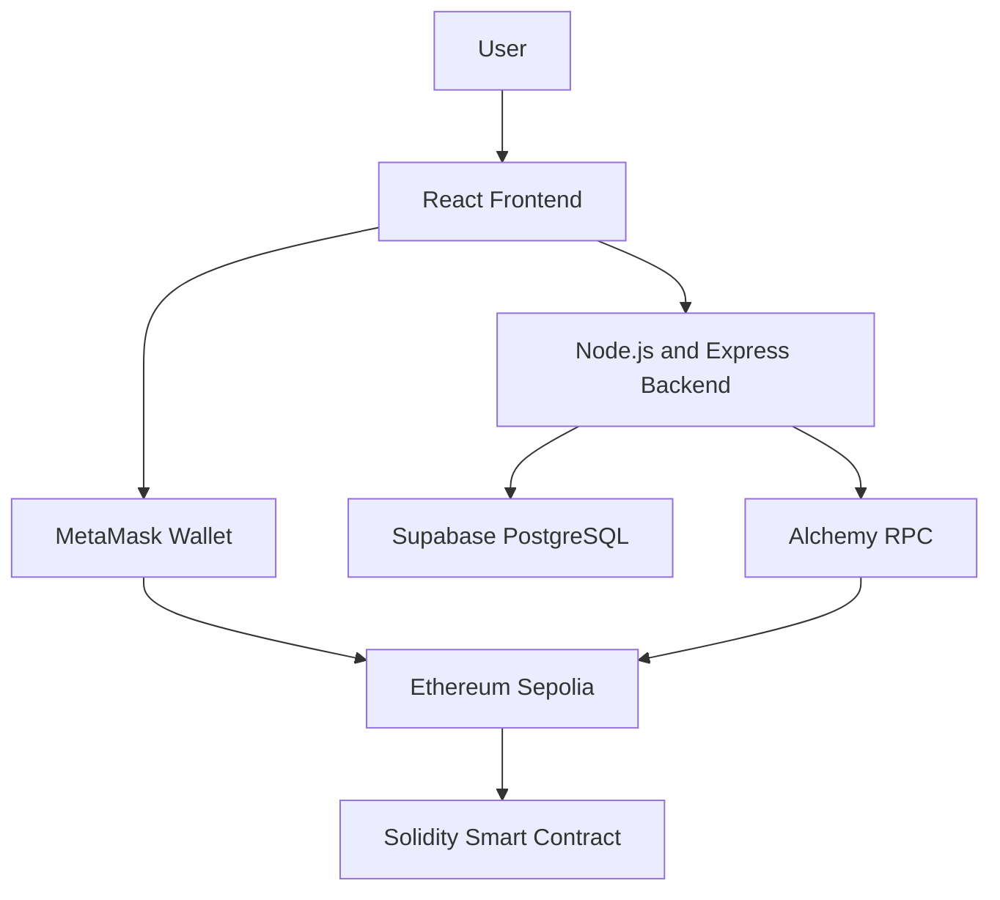
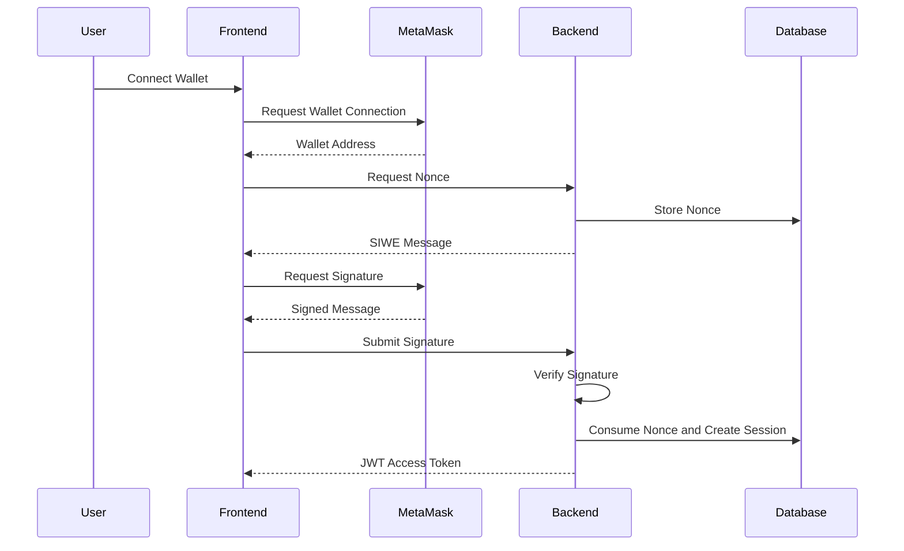

# Ethereum Wallet DApp

A full-stack decentralized application (DApp) that enables users to manage Ethereum transactions through MetaMask and Solidity smart contracts.

Built using React.js, Node.js, Express.js, Ethers.js, Solidity, and Supabase, the application integrates blockchain functionality with wallet-based authentication, transaction verification, and automated transaction history synchronization.

## Features

- MetaMask wallet connection
- Ethereum Sepolia testnet integration
- ETH deposits, withdrawals, and transfers
- Smart contract-based wallet balance management
- Sign-In with Ethereum (SIWE) authentication
- JWT-based session management
- Secure logout and session revocation
- On-chain transaction verification
- Automated transaction history synchronization
- Duplicate transaction prevention
- Wallet account and network change handling
- Automated security and regression testing

## Tech Stack

| Category | Technology |
|---|---|
| Frontend | React.js, Vite, JavaScript |
| Backend | Node.js, Express.js |
| Database | Supabase, PostgreSQL |
| Blockchain | Ethereum Sepolia |
| Smart Contracts | Solidity |
| Blockchain Library | Ethers.js |
| Development Framework | Hardhat |
| Wallet | MetaMask |
| RPC Provider | Alchemy |
| Authentication | SIWE, JWT |
| Validation | Zod |
| Security | Helmet, CORS, Rate Limiting, RLS |
| Version Control | Git, GitHub |

## System Architecture



## Project Structure

```text
eth-wallet-dapp/
├── backend/
├── contracts-project/
├── docs/
├── frontend/
├── .gitignore
├── LICENSE
└── README.md
```

- `backend/` - REST APIs, authentication, middleware, transaction verification, synchronization, and automated tests.
- `contracts-project/` - Solidity smart contracts, deployment scripts, and contract tests.
- `frontend/` - React application, MetaMask integration, and API services.
- `docs/` - Project documentation.

## Smart Contract

The smart contract manages ETH deposits, withdrawals, transfers, and wallet balances on the Ethereum Sepolia testnet.

### Contract Functions

| Function | Description |
|---|---|
| deposit() | Deposit ETH into the smart contract |
| withdraw() | Withdraw ETH from the user's contract balance |
| withdrawToAddress() | Transfer ETH from the user's contract balance |
| getContractBalance() | Retrieve the contract balance |

### Network Information

- Network: Ethereum Sepolia Testnet
- Chain ID: 11155111
- Solidity Version: 0.8.20
- Framework: Hardhat

### Deployed Smart Contract

```text
0xD3F26853AF8cC8f3e41a50305692b754a3dd3d67
```

[View Smart Contract on Sepolia Etherscan](https://sepolia.etherscan.io/address/0xD3F26853AF8cC8f3e41a50305692b754a3dd3d67)

## Authentication Workflow



## Security Implementation

### Authentication and Authorization

- Sign-In with Ethereum (SIWE)
- Cryptographic wallet ownership verification
- One-time nonce generation and replay protection
- JWT-based authentication
- Server-side session validation
- Session expiration and revocation

### Backend Security

- API rate limiting
- Request validation using Zod
- HTTP security headers using Helmet
- CORS configuration
- Environment variable validation
- Protected REST API endpoints

### Database Security

- PostgreSQL Row Level Security (RLS)
- Unique transaction hash constraints
- Database indexing
- Transaction ownership validation

### Blockchain Security

- Transaction receipt verification
- Smart contract address validation
- Chain ID verification
- Transaction sender verification
- Event and transaction amount validation
- Checks-Effects-Interactions pattern

## Database Schema

| Table | Description |
|---|---|
| transactions | Stores verified blockchain transactions |
| wallet_nonces | Stores temporary authentication nonces |
| wallet_sessions | Manages authenticated wallet sessions |
| wallet_sync_state | Tracks blockchain synchronization checkpoints |

## REST API Endpoints

### Authentication

| Method | Endpoint | Description |
|---|---|---|
| POST | /api/auth/nonce | Generate authentication nonce |
| POST | /api/auth/verify | Verify wallet signature |
| GET | /api/auth/me | Validate authenticated session |
| POST | /api/auth/logout | Revoke authenticated session |

### Transactions

| Method | Endpoint | Description |
|---|---|---|
| POST | /api/transactions | Verify and store transaction |
| GET | /api/transactions/:wallet | Retrieve transaction history |
| POST | /api/sync | Synchronize blockchain transactions |

## Local Installation

### Prerequisites

- Node.js 22+
- npm
- Git
- MetaMask browser extension
- Supabase account
- Alchemy account
- Sepolia test ETH

### Clone the Repository

```bash
git clone https://github.com/Sidhant322129/eth-wallet-dapp.git
cd eth-wallet-dapp
```

### Backend Setup

```bash
cd backend
npm ci
```

Create a `.env` file using the provided `.env.example`.

Configure the Supabase database, RPC provider, smart contract address, JWT secret, and other required environment variables.

```bash
npm run dev
```

Backend URL: `http://localhost:5000`

### Frontend Setup

Open a separate terminal from the project root.

```bash
cd frontend
npm ci
```

Configure the frontend environment variables:

```env
VITE_CONTRACT_ADDRESS=your_contract_address
VITE_CHAIN_ID=11155111
VITE_API_URL=http://localhost:5000
```

Start the frontend:

```bash
npm run dev
```

Frontend URL: `http://localhost:5173`

### Smart Contract Setup

From the project root:

```bash
cd contracts-project
npm ci
npx hardhat compile
npx hardhat test
```

The existing Sepolia smart contract can be used without redeployment.

## Testing and Quality Assurance

The project includes automated backend security tests, transaction regression tests, smart contract tests, and frontend validation.

### Reported Development Test Results

| Test Category | Result |
|---|---|
| Backend Security and Regression Tests | 12/12 Passed |
| Smart Contract Tests | 8/8 Passed |
| Live Authentication and Session Tests | 8/8 Passed |
| Frontend Lint | Passed |
| Frontend Production Build | Passed |

### Run Backend Tests

```bash
cd backend
npm test
```

### Run Smart Contract Tests

```bash
cd contracts-project
npx hardhat test
```

### Frontend Validation

```bash
cd frontend
npm run lint
npm run build
```

## Engineering Highlights

- Full-stack Web3 application architecture
- RESTful API development
- Cryptographic wallet authentication
- Database-backed JWT session management
- Blockchain transaction verification
- Incremental blockchain event synchronization
- Secure API and database architecture
- Automated testing and regression prevention
- Modular and maintainable codebase

## Current Development Status

- [x] Smart contract development
- [x] Smart contract deployment on Sepolia
- [x] MetaMask integration
- [x] Frontend development
- [x] Backend development
- [x] Database integration
- [x] SIWE authentication
- [x] JWT session management
- [x] Transaction verification
- [x] Blockchain synchronization
- [x] Security hardening implementation
- [x] Automated testing
- [x] GitHub repository setup
- [ ] CI/CD automation
- [ ] Backend hosting
- [ ] Frontend hosting
- [ ] Live application testing
- [ ] Production monitoring

The application is currently in the pre-deployment stage.

## Disclaimer

This project is developed for educational and demonstration purposes using the Ethereum Sepolia testnet.

The smart contract has not undergone an independent professional security audit and is not intended for mainnet usage or real financial assets.

Final production security verification is pending.

## License

This repository includes the GNU General Public License v3.0. See the LICENSE file and individual source file license notices for details.

## Author

**Sidhant Hansda**

B.Tech in Information Technology  
Heritage Institute of Technology, Kolkata

[GitHub Profile](https://github.com/Sidhant322129)
