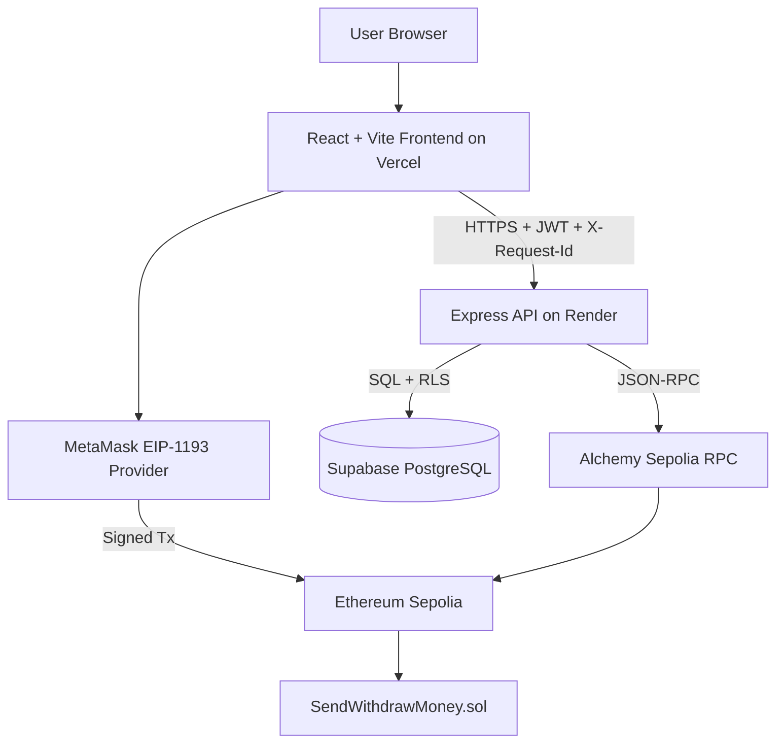
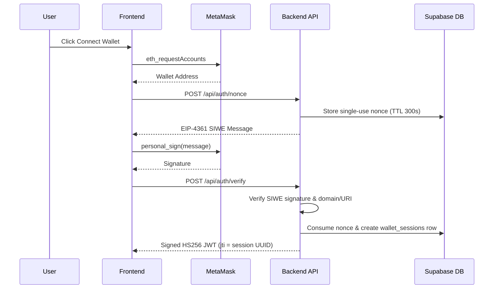
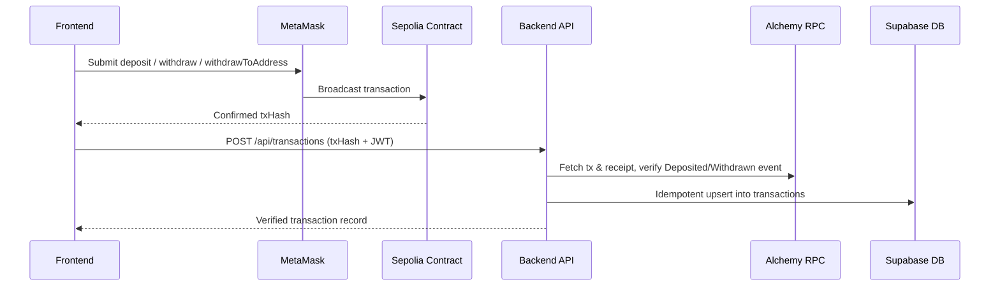
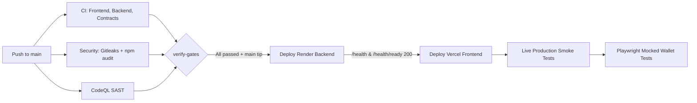
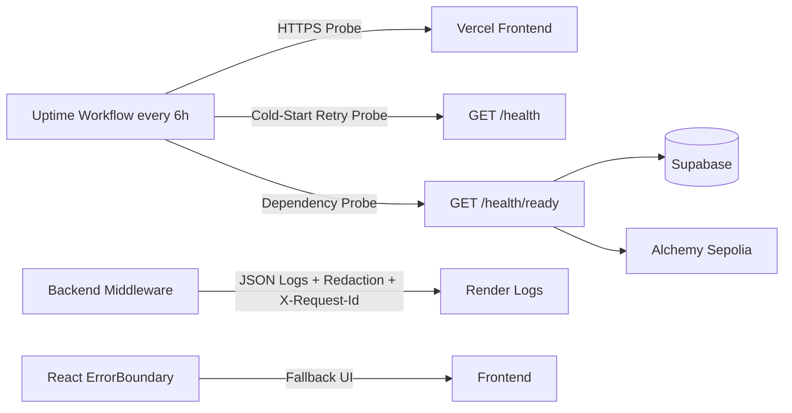

# Ethereum Wallet DApp (`SendWithdrawMoney`)

[](https://github.com/Sidhant322129/eth-wallet-dapp/actions/workflows/ci.yml)
[](https://github.com/Sidhant322129/eth-wallet-dapp/actions/workflows/security.yml)
[](https://github.com/Sidhant322129/eth-wallet-dapp/actions/workflows/codeql.yml)
[](https://github.com/Sidhant322129/eth-wallet-dapp/actions/workflows/cd.yml)
[](https://github.com/Sidhant322129/eth-wallet-dapp/actions/workflows/uptime.yml)
[](LICENSE)

A production-hardened, full-stack Web3 decentralized vault application built on **Ethereum Sepolia**, **React + Vite**, **Node.js + Express**, **Supabase PostgreSQL**, and **Solidity**, featuring **Sign-In with Ethereum (SIWE)** authentication, **database-backed JWT session revocation**, **on-chain transaction receipt verification**, **automated CI/CD with security gates**, and **structured observability**.

---

## Live Deployment

| Component | URL / Address |
|---|---|
| **Frontend (Vercel)** | [https://eth-wallet-dapp-eta.vercel.app](https://eth-wallet-dapp-eta.vercel.app) |
| **Backend API (Render)** | [https://eth-wallet-dapp-backend.onrender.com](https://eth-wallet-dapp-backend.onrender.com) ([`/health`](https://eth-wallet-dapp-backend.onrender.com/health)) |
| **Smart Contract (Sepolia)** | [`0xD3F26853AF8cC8f3e41a50305692b754a3dd3d67`](https://sepolia.etherscan.io/address/0xD3F26853AF8cC8f3e41a50305692b754a3dd3d67) |

---

## Problem Statement & Overview

Decentralized applications that combine non-custodial smart contracts with off-chain transaction history face three core engineering challenges:
1. **Unauthenticated wallet spoofing**: Anyone can submit a public Ethereum address unless ownership is proven cryptographically.
2. **Off-chain/on-chain data tampering**: Client-submitted transaction amounts or recipients cannot be trusted without independent on-chain receipt and event-log verification.
3. **Production operational reliability**: Free-tier Web3 deployments require strict CORS/SIWE alignment, rate limiting, secret hygiene, automated security gates, and cold-start-tolerant monitoring.

This project solves all three through EIP-4361 SIWE authentication, server-side `eth_getTransactionReceipt` event validation, Supabase PostgreSQL Row Level Security (RLS), and a fully gated GitHub Actions CI/CD pipeline.

---

## Key Features

- **Non-Custodial Smart Contract Vault**: Deposit, withdraw, and transfer ETH on Ethereum Sepolia with Checks-Effects-Interactions reentrancy protection.
- **SIWE & Revocable JWT Sessions**: Cryptographic EIP-4361 wallet authentication, single-use nonce replay protection, `HS256` JWT claims validation, and immediate database-backed logout revocation.
- **On-Chain Transaction Verification & Sync**: Independent Sepolia RPC receipt/log verification, duplicate `tx_hash` prevention, and bounded incremental block-history synchronization.
- **Defense-in-Depth API Security**: Zod schema & environment validation, Helmet security headers (HSTS in production), strict `https://` CORS allowlist, multi-tier IP and wallet-scoped rate limiting, and Supabase RLS.
- **Automated DevSecOps CI/CD**: GitHub Actions CI, CodeQL SAST, Gitleaks full-history secret scanning, `npm audit` gates, Dependabot, gated Render/Vercel deployments, live smoke tests, and Playwright mocked EIP-1193 browser tests.
- **Observability & Error Resilience**: Structured JSON logging with `X-Request-Id` correlation, automatic secret/wallet redaction, `/health` & `/health/ready` probes, scheduled 6-hour uptime checks, and React `ErrorBoundary`.

---

## Technology Stack

| Layer | Technologies |
|---|---|
| **Frontend** | [React 19](https://react.dev/), [Vite](https://vite.dev/), [Ethers.js v6](https://docs.ethers.org/v6/), [MetaMask](https://docs.metamask.io/) |
| **Backend** | [Node.js 22](https://nodejs.org/), [Express 5](https://expressjs.com/), [SIWE](https://docs.login.xyz/), [JSON Web Tokens](https://github.com/auth0/node-jsonwebtoken), [Zod](https://zod.dev/), [Helmet](https://helmetjs.github.io/), [express-rate-limit](https://express-rate-limit.mintlify.app/) |
| **Database** | [Supabase](https://supabase.com/docs) ([PostgreSQL](https://www.postgresql.org/docs/) + Row Level Security) |
| **Blockchain** | [Solidity 0.8.20](https://docs.soliditylang.org/), [Hardhat 2](https://hardhat.org/docs), [Ethereum Sepolia](https://sepolia.etherscan.io/), [Alchemy RPC](https://docs.alchemy.com/) |
| **DevSecOps & QA** | [GitHub Actions](https://docs.github.com/en/actions), [CodeQL](https://codeql.github.com/), [Gitleaks](https://gitleaks.io/), [Dependabot](https://docs.github.com/en/code-security/dependabot), [Playwright](https://playwright.dev/), [Render](https://render.com/docs), [Vercel](https://vercel.com/docs) |

---

## System Architecture



## Authentication Flow



## Blockchain Transaction Verification Flow



## CI/CD Pipeline



## Monitoring & Observability Architecture



---

## Database Architecture

| Table | Purpose | Key Protections |
|---|---|---|
| `transactions` | Verified deposit, withdraw, and transfer records | Unique `tx_hash`, `NOT NULL` `block_number` & `created_at`, RLS |
| `wallet_nonces` | Ephemeral SIWE login challenges | Single-use consumption, `expires_at` TTL, RLS |
| `wallet_sessions` | Active and revoked JWT sessions (`jti` UUID) | Immediate `revoked_at` invalidation on logout, RLS |
| `wallet_sync_state` | Incremental blockchain sync checkpoints | Per-wallet `last_synced_block`, RLS |

---

## Repository Structure

```text
eth-wallet-dapp/
├── .github/
│   ├── dependabot.yml
│   └── workflows/
│       ├── cd.yml
│       ├── ci.yml
│       ├── codeql.yml
│       ├── security.yml
│       └── uptime.yml
├── backend/
│   ├── config/          # Zod env validation & Supabase client
│   ├── controllers/     # Auth, transaction, and sync handlers
│   ├── middleware/      # JWT auth, rate limits, Zod validation, requestLogger
│   ├── migrations/      # PostgreSQL schema & constraint migrations
│   ├── routes/          # Express route definitions
│   ├── services/        # SIWE, session, blockchain verification, sync logic
│   ├── tests/           # Security, regression, health, monitoring tests
│   ├── utils/           # Structured JSON logger with secret redaction
│   ├── .env.example
│   ├── package.json
│   └── server.js
├── contracts-project/
│   ├── contracts/       # SendWithdrawMoney.sol
│   ├── scripts/         # Hardhat deployment script
│   ├── test/            # Hardhat smart contract tests
│   ├── .env.example
│   ├── hardhat.config.js
│   └── package.json
├── docs/                # Phase reports & security audit documentation
├── frontend/
│   ├── contracts/       # ABI & contract helper
│   ├── src/
│   │   ├── components/  # ErrorBoundary
│   │   ├── services/    # authApi, TransactionApi, walletAuthFlow
│   │   ├── App.jsx
│   │   └── main.jsx
│   ├── tests/           # Auth reliability & Playwright mocked-wallet tests
│   ├── .env.example
│   ├── package.json
│   └── vercel.json
├── scripts/
│   ├── cdGateCheck.mjs
│   ├── cdGateCheck.test.mjs
│   └── smokeTestProduction.mjs
├── LICENSE
├── README.md
└── render.yaml
```

---

## Local Installation & Setup

### Prerequisites
- Node.js `22+` and `npm`
- MetaMask browser extension
- Supabase project, Alchemy Sepolia RPC key, and Sepolia test ETH

### 1. Clone the Repository
```bash
git clone https://github.com/Sidhant322129/eth-wallet-dapp.git
cd eth-wallet-dapp
```

### 2. Backend Setup
```bash
cd backend
npm ci
cp .env.example .env
```
Populate `backend/.env` with your own local values (never commit `.env`):
```dotenv
PORT=5000
NODE_ENV=development
ALLOWED_ORIGINS=http://localhost:5173,http://localhost:5174
SIWE_DOMAIN=localhost:5173
SIWE_URI=http://localhost:5173
SIWE_CHAIN_ID=11155111
NONCE_TTL_SECONDS=300
SUPABASE_URL=https://your-project-id.supabase.co
SUPABASE_SECRET_KEY=sb_secret_your_local_key_here
SEPOLIA_RPC_URL=https://eth-sepolia.g.alchemy.com/v2/YOUR_ALCHEMY_API_KEY
CONTRACT_ADDRESS=0xD3F26853AF8cC8f3e41a50305692b754a3dd3d67
JWT_SECRET=replace_with_64_random_bytes_hex
JWT_EXPIRES_IN=1h
CONTRACT_DEPLOYMENT_BLOCK=12203912
SYNC_BLOCK_RANGE=10
SYNC_MAX_BLOCKS=200
SYNC_CONFIRMATIONS=12
```
Start the backend:
```bash
npm run dev
```

### 3. Frontend Setup
```bash
cd frontend
npm ci
cp .env.example .env
```
Configure `frontend/.env`:
```dotenv
VITE_CONTRACT_ADDRESS=0xD3F26853AF8cC8f3e41a50305692b754a3dd3d67
VITE_CHAIN_ID=11155111
VITE_API_URL=http://localhost:5000/api
```
Start the frontend:
```bash
npm run dev
```

### 4. Smart Contract Tests
```bash
cd contracts-project
npm ci
npx hardhat compile
npx hardhat test
```

---

## REST API Endpoints

| Method | Endpoint | Auth | Description |
|---|---|---|---|
| `GET` | `/` | Public | Service status banner |
| `GET` | `/health` | Public | Fast process liveness check (`200`) |
| `GET` | `/health/ready` | Public | Bounded Supabase + Sepolia RPC readiness (`200` / `503`) |
| `POST` | `/api/auth/nonce` | Public | Generate single-use EIP-4361 SIWE challenge |
| `POST` | `/api/auth/verify` | Public | Verify signature, consume nonce, issue JWT |
| `GET` | `/api/auth/me` | Bearer JWT | Validate active session & wallet identity |
| `POST` | `/api/auth/logout` | Bearer JWT | Revoke current session in Supabase |
| `POST` | `/api/transactions` | Bearer JWT | Verify Sepolia receipt/event & store transaction |
| `GET` | `/api/transactions/:wallet` | Bearer JWT | Fetch wallet-owned transaction history |
| `POST` | `/api/sync` | Bearer JWT | Incrementally sync up to 200 blocks from Sepolia |

---

## Testing & Verification

| Suite | Command | Latest Observed Result |
|---|---|---|
| **Backend Unit, Security & Monitoring** | `cd backend && npm test` | `19/19` passed (`4` suites) |
| **Frontend Lint & Build** | `cd frontend && npm run lint && npm run build` | `0` lint errors, `188` modules built |
| **Frontend Auth Reliability** | `cd frontend && npm test` | `7/7` passed (mocked providers/API) |
| **Frontend Playwright Browser** | `cd frontend && npm run test:browser` | `3/3` passed (mocked EIP-1193 provider) |
| **Smart Contracts** | `cd contracts-project && npx hardhat test` | `8/8` passed |
| **CD Gate Simulation** | `node --test scripts/cdGateCheck.test.mjs` | `5/5` passed |
| **Live Production Smoke Suite** | `node scripts/smokeTestProduction.mjs` | `22/22` passed |
| **Production Dependency Audits** | `npm audit --omit=dev` (all 3 packages) | `0` production vulnerabilities |

---

## Known Limitations & Future Improvements

- **Testnet Scope**: Deployed on Ethereum Sepolia for demonstration; `SendWithdrawMoney.sol` has not undergone a third-party paid smart contract audit and is not intended for mainnet funds.
- **Free-Tier Cold Starts**: Render free-tier instances sleep after inactivity (~30–50s wake latency), handled by bounded retries and a 60s frontend auth timeout.
- **External Error Alerting**: React `ErrorBoundary` and structured JSON logging are active; optional Sentry DSN integration is documented in `docs/PHASE_5_7_MONITORING_REPORT.md` pending external account setup.
- **Future Work**: Code-splitting the 515 kB frontend bundle, adding multi-chain support, and integrating Slither/Foundry static analysis for Solidity.

---

## License

Licensed under the **GNU General Public License v3.0** — see [LICENSE](LICENSE).

## Author

**Sidhant Hansda**  
B.Tech in Information Technology, Heritage Institute of Technology, Kolkata  
[GitHub: @Sidhant322129](https://github.com/Sidhant322129)
