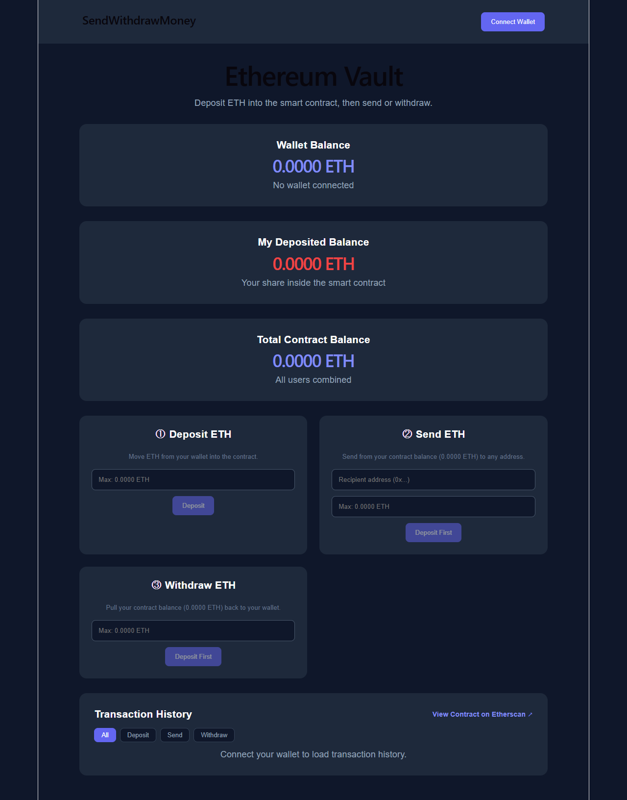
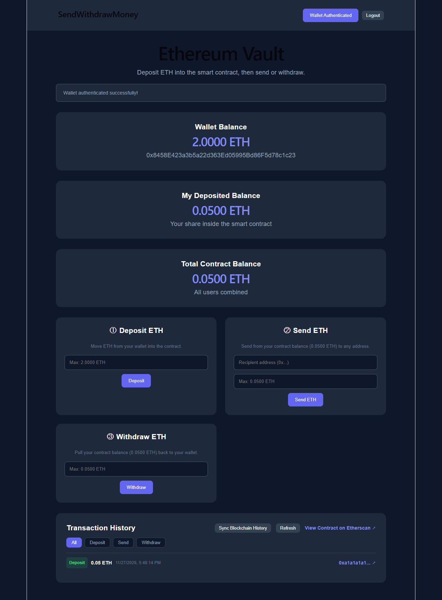
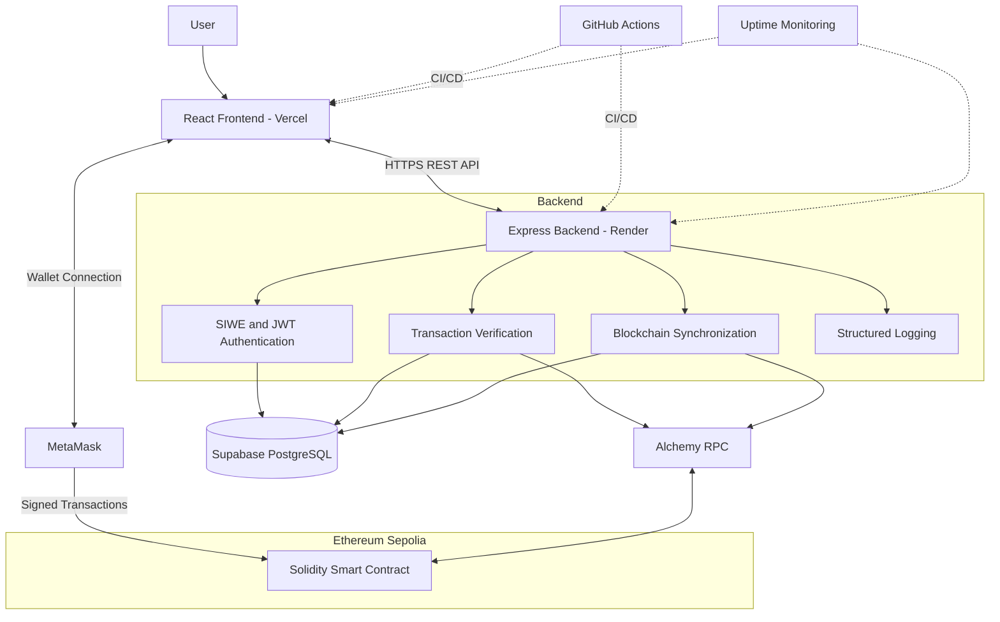
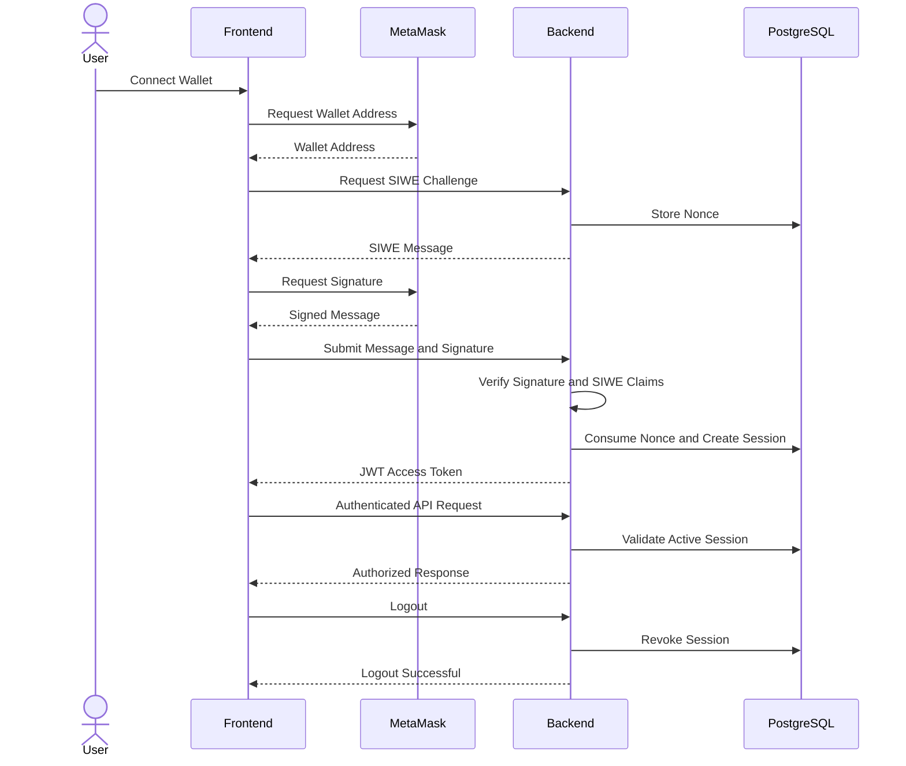
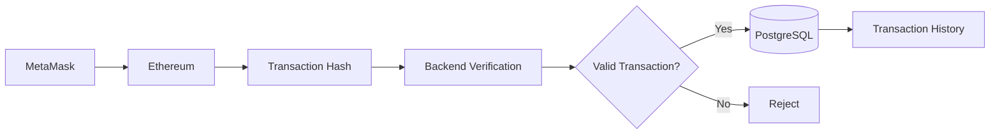
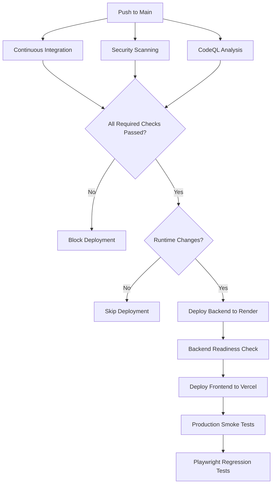

<div align="center">

# Ethereum Wallet DApp

**A full-stack decentralized Ethereum vault with secure wallet authentication, on-chain transaction verification and automated CI/CD.**

[](https://eth-wallet-dapp-eta.vercel.app)
[](https://eth-wallet-dapp-backend.onrender.com/health)
[](https://sepolia.etherscan.io/address/0xD3F26853AF8cC8f3e41a50305692b754a3dd3d67)

[](https://github.com/Sidhant322129/eth-wallet-dapp/actions/workflows/ci.yml)
[](https://github.com/Sidhant322129/eth-wallet-dapp/actions/workflows/security.yml)
[](https://github.com/Sidhant322129/eth-wallet-dapp/actions/workflows/codeql.yml)
[](https://github.com/Sidhant322129/eth-wallet-dapp/actions/workflows/cd.yml)
[](https://github.com/Sidhant322129/eth-wallet-dapp/actions/workflows/uptime.yml)


[Live Application](https://eth-wallet-dapp-eta.vercel.app) ·
[Documentation](docs/) ·
[Smart Contract](https://sepolia.etherscan.io/address/0xD3F26853AF8cC8f3e41a50305692b754a3dd3d67)

</div>

---

## Overview

Ethereum Wallet DApp is a decentralized application that enables users to deposit, withdraw and transfer ETH through a Solidity-based smart contract vault.

The application integrates MetaMask for wallet connectivity and transaction signing, Sign-In with Ethereum (SIWE) for authentication, and a Node.js backend for independent blockchain transaction verification and persistent transaction history.

Built with React, Express, Solidity and PostgreSQL, the application includes automated security scanning, continuous deployment, structured logging and production availability monitoring.

The smart contract is deployed on the Ethereum Sepolia testnet.

## Features

### Blockchain & Wallet

- MetaMask wallet integration
- Smart contract-based ETH deposits and withdrawals
- ETH transfers from vault balances to external addresses
- Real-time on-chain balance retrieval
- Verified blockchain transaction history
- Incremental blockchain event synchronization
- Wallet account and network change handling

### Authentication & Security

- Sign-In with Ethereum (EIP-4361)
- Single-use authentication nonces with expiration
- JWT authentication with database-backed session revocation
- Wallet-scoped authorization and replay protection
- Zod request validation, Helmet, CORS and API rate limiting
- PostgreSQL Row Level Security and database constraints

### DevOps & Reliability

- Automated testing and security-gated CI/CD
- Automated Render and Vercel deployments
- Production smoke tests and browser regression tests
- Structured JSON logging with sensitive data redaction
- Request correlation IDs and health checks
- Scheduled uptime monitoring
- Frontend error recovery

## Screenshots

### Application

<div align="center">
  
</div>

### Wallet Dashboard

<div align="center">
  
</div>

*Dashboard captured using a mocked wallet provider and API for demonstration purposes.*

## Technology Stack

### Frontend

[](https://react.dev/)
[](https://vite.dev/)
[](https://developer.mozilla.org/en-US/docs/Web/JavaScript)
[](https://developer.mozilla.org/en-US/docs/Web/HTML)
[](https://developer.mozilla.org/en-US/docs/Web/CSS)

### Backend & Database

[](https://nodejs.org/)
[](https://expressjs.com/)
[](https://supabase.com/docs)
[](https://www.postgresql.org/docs/)

### Blockchain & Web3

[](https://docs.soliditylang.org/)
[](https://ethereum.org/developers/)
[](https://hardhat.org/docs)
[](https://docs.ethers.org/v6/)
[](https://docs.metamask.io/)
[](https://www.alchemy.com/docs)

### Authentication & Security

[](https://eips.ethereum.org/EIPS/eip-4361)
[](https://jwt.io/)
[](https://zod.dev/)
[](https://helmetjs.github.io/)
[](https://supabase.com/docs/guides/database/postgres/row-level-security)

### DevOps & Testing

[](https://git-scm.com/doc)
[](https://docs.github.com/)
[](https://docs.github.com/en/actions)
[](https://vercel.com/docs)

[](https://render.com/docs)
[](https://playwright.dev/)
[](https://codeql.github.com/)
[](https://github.com/gitleaks/gitleaks)
[](https://docs.github.com/en/code-security/dependabot)

## System Architecture



The blockchain serves as the source of truth for balances and transaction execution. The backend independently verifies on-chain transactions and maintains indexed transaction history in PostgreSQL.

Wallet private keys remain under the user's control through MetaMask.

## Smart Contract

| Property | Details |
|---|---|
| Contract | `SendWithdrawMoney` |
| Language | Solidity 0.8.20 |
| Network | Ethereum Sepolia |
| Chain ID | `11155111` |
| Framework | Hardhat |
| Address | `0xD3F26853AF8cC8f3e41a50305692b754a3dd3d67` |

[View contract on Sepolia Etherscan](https://sepolia.etherscan.io/address/0xD3F26853AF8cC8f3e41a50305692b754a3dd3d67)

The contract maintains individual wallet balances, supports ETH deposits and withdrawals, and emits events for transaction verification and historical indexing.

Withdrawal balances are updated before external value transfers, following the checks-effects-interactions pattern.

## Authentication Flow



Authentication uses cryptographic wallet signatures rather than passwords. JWT sessions are validated against persistent database records, allowing immediate session revocation.

## Transaction Verification



The backend validates transaction receipts, contract addresses, event data, wallet ownership, amounts and recipients before persisting transaction records.

Historical synchronization uses bounded block ranges, confirmation buffers and persistent per-wallet checkpoints to avoid repeatedly scanning the entire blockchain.

## Database

PostgreSQL is used for transaction indexing, authentication state and synchronization checkpoints.

| Table | Responsibility |
|---|---|
| `transactions` | Verified blockchain transaction history |
| `wallet_nonces` | Temporary SIWE authentication challenges |
| `wallet_sessions` | Authentication sessions and revocation |
| `wallet_sync_state` | Per-wallet blockchain synchronization checkpoints |

Database integrity is maintained through unique transaction hashes, required field constraints, Row Level Security and backend authorization.

## API Reference

| Method | Endpoint | Description |
|---|---|---|
| POST | `/api/auth/nonce` | Generate SIWE challenge |
| POST | `/api/auth/verify` | Verify wallet signature |
| GET | `/api/auth/me` | Retrieve authenticated session |
| POST | `/api/auth/logout` | Revoke session |
| POST | `/api/transactions` | Verify and persist transaction |
| GET | `/api/transactions/:wallet` | Retrieve wallet transaction history |
| POST | `/api/sync` | Synchronize blockchain events |
| GET | `/health` | Application liveness |
| GET | `/health/ready` | Database and RPC readiness |

Protected endpoints require a valid Bearer JWT and active wallet session.

```http
Authorization: Bearer <access_token>
```

For request schemas, response formats and error codes, see the [API documentation](docs/API_DOCUMENTATION.md).

## Security

| Layer | Implementation |
|---|---|
| Authentication | EIP-4361 SIWE and JWT |
| Authorization | Wallet ownership and active session validation |
| Replay Protection | Single-use, time-limited nonces |
| Input Validation | Zod |
| HTTP Security | Helmet and strict CORS |
| Abuse Prevention | API rate limiting |
| Database Security | PostgreSQL RLS and constraints |
| Transaction Integrity | Independent on-chain verification |
| Secret Management | Environment variables and GitHub Secrets |
| Security Automation | CodeQL, Gitleaks, npm audit and Dependabot |
| Logging Privacy | Sensitive data redaction |

Production dependency audits reported zero vulnerabilities at the time of the final validation.

See the [security documentation](docs/SECURITY.md) for security controls and limitations.

## CI/CD



GitHub Actions automates application testing, dependency auditing, secret scanning, static analysis and production deployment.

Deployment gates enforce successful required checks, commit eligibility and duplicate deployment prevention. Documentation-only changes skip unnecessary production deployments.

## Monitoring & Observability

The application includes operational monitoring through:

- Structured JSON application logs
- `X-Request-Id` request correlation
- Sensitive credential and signature redaction
- HTTP response status and duration logging
- Application liveness and dependency readiness checks
- React error boundary and recovery interface
- Automated uptime checks every six hours

| Service | Monitoring Endpoint |
|---|---|
| Frontend | [Application](https://eth-wallet-dapp-eta.vercel.app) |
| Backend Liveness | [/health](https://eth-wallet-dapp-backend.onrender.com/health) |
| Backend Readiness | [/health/ready](https://eth-wallet-dapp-backend.onrender.com/health/ready) |

Readiness checks validate Supabase and Ethereum RPC connectivity. Unavailable dependencies result in HTTP `503`.

Uptime monitoring runs independently of the deployment pipeline.

## Testing

The application includes automated regression, smart contract, browser, deployment and live production tests.

| Test Suite | Passed |
|---|---:|
| Backend Regression Tests | 20/20 |
| Frontend Tests | 7/7 |
| Smart Contract Tests | 8/8 |
| Playwright Browser Tests | 3/3 |
| Deployment Gate Tests | 7/7 |
| Uptime Monitoring Tests | 3/3 |
| Production Smoke Tests | 22/22 |
| **Total** | **70/70** |

Additional validation includes ESLint, production builds, CodeQL, Gitleaks and production dependency audits.

Backend and browser regression tests use mocked external dependencies. Smart contract tests execute against a local Hardhat EVM, while production smoke tests validate live deployed services.

## Project Structure

```text
eth-wallet-dapp/
├── .github/
│   ├── workflows/
│   └── dependabot.yml
├── backend/
│   ├── config/
│   ├── controllers/
│   ├── middleware/
│   ├── routes/
│   ├── services/
│   ├── tests/
│   ├── utils/
│   └── server.js
├── frontend/
│   ├── src/
│   ├── tests/
│   └── vercel.json
├── contracts-project/
│   ├── contracts/
│   ├── test/
│   └── hardhat.config.js
├── scripts/
├── docs/
├── .gitignore
├── LICENSE
└── README.md
```

## Getting Started

### Prerequisites

- Node.js 22 and npm
- Git
- MetaMask browser extension
- Supabase project
- Ethereum Sepolia RPC endpoint

### Clone the Repository

```bash
git clone https://github.com/Sidhant322129/eth-wallet-dapp.git
cd eth-wallet-dapp
```

### Backend Setup

```bash
cd backend
npm ci
```

Create a `.env` file using `.env.example` and configure the database, RPC endpoint, contract address, JWT secret, SIWE settings and allowed origins.

Initialize the database according to the [database schema documentation](docs/DATABASE_SCHEMA.md).

Start the backend:

```bash
npm run dev
```

The backend runs at `http://localhost:5000`.

### Frontend Setup

Open a separate terminal from the repository root:

```bash
cd frontend
npm ci
```

Create a `.env` file using `.env.example` and configure the public API URL, contract address and Sepolia chain ID.

Start the frontend:

```bash
npm run dev
```

The frontend runs at `http://localhost:5173`.

### Smart Contract Setup

From the repository root:

```bash
cd contracts-project
npm ci
npx hardhat compile
npx hardhat test
```

The existing Sepolia contract can be used without redeployment.

Never commit private keys, database credentials, RPC credentials or JWT secrets.

## Running Tests

### Backend

```bash
cd backend
npm test
```

### Frontend

```bash
cd frontend
npm run lint
npm test
npm run build
```

### Browser

```bash
cd frontend
npx playwright install chromium
npm run build
npm run test:browser
```

### Smart Contract

```bash
cd contracts-project
npx hardhat test
```

### Deployment & Monitoring

Run from the repository root:

```bash
node --test scripts/cdGateCheck.test.mjs scripts/uptimeCheck.test.mjs
node scripts/smokeTestProduction.mjs
node scripts/uptimeCheck.mjs
```

## Deployment

| Component | Platform |
|---|---|
| Frontend | [Vercel](https://eth-wallet-dapp-eta.vercel.app) |
| Backend | [Render](https://eth-wallet-dapp-backend.onrender.com) |
| Database | Supabase PostgreSQL |
| Smart Contract | Ethereum Sepolia |
| Blockchain RPC | Alchemy |
| CI/CD | GitHub Actions |

Production credentials are managed through provider environment settings and GitHub Actions secrets.

See the [deployment guide](docs/DEPLOYMENT_GUIDE.md) for infrastructure configuration.

## Documentation

| Document | Description |
|---|---|
| [Architecture](docs/ARCHITECTURE.md) | System design and component interactions |
| [API Reference](docs/API_DOCUMENTATION.md) | REST API and authentication |
| [Database Schema](docs/DATABASE_SCHEMA.md) | Data models and access policies |
| [Security](docs/SECURITY.md) | Security controls and threat mitigation |
| [Deployment](docs/DEPLOYMENT_GUIDE.md) | Infrastructure and CI/CD |
| [Testing](docs/TESTING_GUIDE.md) | Test suites and validation |
| [Monitoring](docs/MONITORING_RUNBOOK.md) | Observability and incident response |

## Limitations

- The application is intended for Ethereum Sepolia testnet use.
- The smart contract has not undergone an independent professional security audit.
- Render free-tier cold starts may affect initial response times.
- In-memory rate limiting and synchronization locks assume a single backend instance.
- Confirmation-aware synchronization reduces but does not eliminate blockchain reorganization risks.
- Some development dependency advisories remain pending compatible upgrades.

## License

Distributed under the GNU General Public License v3.0.

See [LICENSE](LICENSE) for details.

## Author

**Sidhant Hansda**

Full-Stack Developer | Blockchain & Web3

[](https://github.com/Sidhant322129)

---

<div align="center">

Built with React, Node.js, Solidity and Ethereum.

</div>
