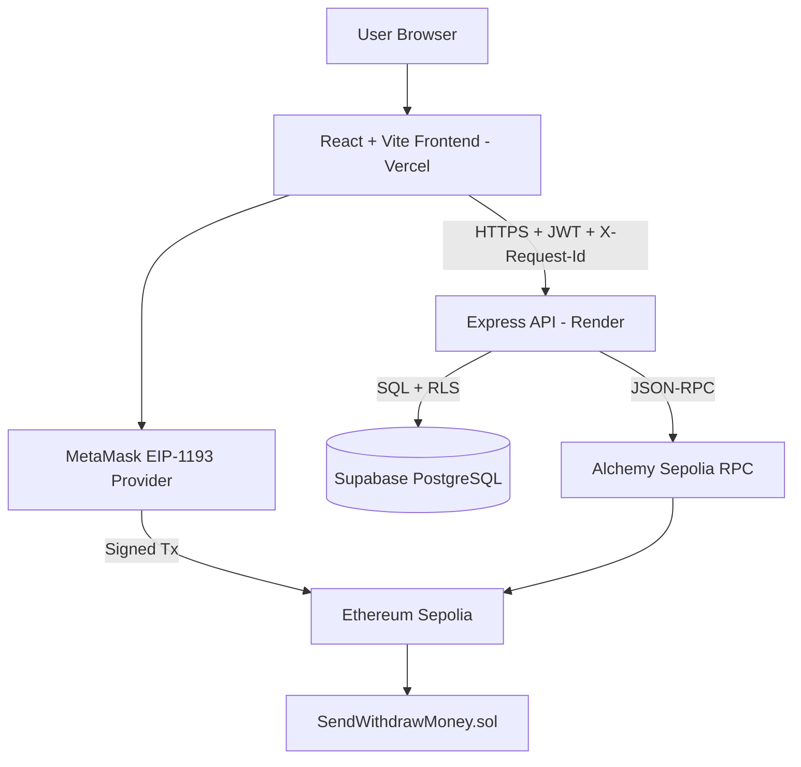

# System Architecture

## Overview
`eth-wallet-dapp` combines a non-custodial Ethereum Sepolia smart contract vault (`SendWithdrawMoney.sol`), a React + Vite frontend on Vercel, an Express + Node.js 22 backend on Render, and Supabase PostgreSQL with Row Level Security (RLS).

## Component Responsibilities
- **Frontend (`frontend/`)**: MetaMask EIP-1193 integration, SIWE signing, generation-guarded auth state (`walletAuthFlow.js`), bounded 60s fetch timeouts (`authApi.js`), and React `ErrorBoundary`.
- **Backend (`backend/`)**: Zod env/request validation, Helmet, strict CORS, IP/wallet rate limiters, SIWE nonce & signature verification, `HS256` JWT + Supabase session revocation, on-chain receipt verification, incremental block sync, structured JSON logging with redaction, and `/health` + `/health/ready`.
- **Database (Supabase)**: PostgreSQL storing `transactions`, `wallet_nonces`, `wallet_sessions`, and `wallet_sync_state`.
- **Smart Contract (`contracts-project/`)**: `SendWithdrawMoney.sol` (Solidity `0.8.20`) deployed at `0xD3F26853AF8cC8f3e41a50305692b754a3dd3d67` on Sepolia (`11155111`, block `12203912`).
